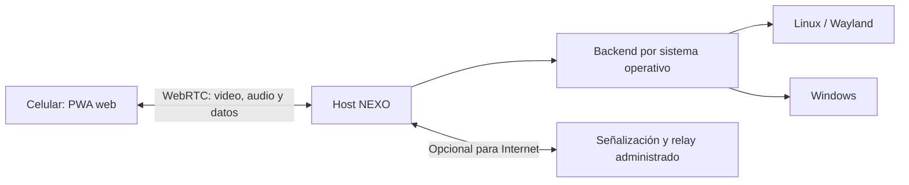

# NEXO / Letzus — proyecto de control remoto táctil

> **Documento histórico, del 1 de agosto de 2026.** Conserva la visión comercial, el
> análisis de alternativas y el estudio de migración a Windows, que siguen siendo
> válidos como referencia. Su backlog técnico está superado: el plan de trabajo vigente
> es `PROYECTO-NEXO-EVOLUCION.md` y el inventario de pendientes, `PROGRESO.md`. No
> tomes de aquí prioridades ni estado del sistema.

## Resumen ejecutivo

NEXO es una superficie de control remoto que convierte un celular en pantalla táctil, teclado, mouse y receptor de audio para una computadora. El cliente funciona directamente en el navegador y puede utilizarse tanto dentro de la red local como mediante un enlace remoto.

El prototipo actual demuestra que la idea es técnicamente viable y útil. El siguiente paso no consiste en agregar funciones indiscriminadamente, sino en convertir el MVP en un producto instalable, seguro, estable y fácil de configurar.

La migración para controlar una PC con Windows también es viable. La interfaz web y una parte importante del protocolo pueden conservarse; la captura de pantalla, audio, entrada y administración del proceso anfitrión deben implementarse con APIs nativas de Windows.

## Visión del producto

**Propuesta:** controlar una computadora desde cualquier celular, sin instalar una aplicación móvil, mediante una interfaz táctil personalizada y de baja latencia.

**Diferenciadores actuales:**

- Funciona desde el navegador móvil.
- Combina pantalla, tacto, teclado, audio y cambio de escritorios.
- Tiene modo local y acceso desde otro Internet.
- Puede adaptarse visualmente a una identidad propia.
- Está pensado como una superficie táctil, no solamente como un escritorio remoto en miniatura.

**Posicionamiento recomendado:** una alternativa ligera y económica para transformar el celular en una extensión táctil de Linux o Windows.

## Estado actual del MVP

El prototipo desarrollado incluye:

- Visualización en vivo de la pantalla del computador.
- Interacción táctil y mapeo de coordenadas.
- Manejo manual de orientación para mantener el mapeo correcto.
- Teclado móvil con escritura en tiempo real y modo de envío con Enter.
- Audio del sistema reproducido en el celular.
- Cambio entre escritorios.
- Controles laterales ocultables y mecanismo para recuperarlos.
- Pantalla completa y reanudación después de bloquear el celular.
- Acceso local y acceso remoto temporal mediante Cloudflare Quick Tunnel.
- Estética personalizada Letzus/NEXO inspirada en Viego para uso personal.

El MVP es estable para experimentación personal, pero todavía no debe presentarse como producto comercial sin resolver seguridad, distribución, propiedad visual y compatibilidad.

## Arquitectura objetivo



La separación fundamental debe ser:

1. **Cliente web/PWA:** interfaz, gestos, teclado, rotación, controles y reproducción multimedia.
2. **Protocolo compartido:** eventos de puntero, teclado, escritorios, estado, autenticación y negociación multimedia.
3. **Host común:** servidor, emparejamiento, sesiones, actualización y telemetría opcional.
4. **Backend por plataforma:** implementación nativa de pantalla, sonido, teclado, mouse y escritorios.
5. **Infraestructura remota opcional:** señalización WebRTC, TURN/relay y administración de dispositivos.

Una estructura futura posible sería:

```text
apps/
  client-web/
  host-linux/
  host-windows/
packages/
  protocol/
  design-system/
  host-core/
services/
  signaling/
  relay/
```

## Comparación con productos existentes

| Producto | Enfoque principal | Ventaja conocida | Oportunidad para NEXO |
|---|---|---|---|
| [RustDesk](https://rustdesk.com/docs/en/) | Escritorio remoto completo y autoalojable | Multiplataforma, códecs modernos y servidor propio | Ser más sencillo, táctil y personalizable para uso cercano |
| [KDE Connect](https://apps.kde.org/kdeconnect/) | Integración entre móvil y escritorio | Archivos, portapapeles, notificaciones y control remoto | Ofrecer pantalla y audio en una sola experiencia web |
| [Unified Remote](https://www.unifiedremote.com/features) | Controles remotos especializados | Gran catálogo de controles por aplicación | Combinar controles específicos con una superficie visual real |
| [Touch Portal](https://touchportal.com/) | Panel de macros configurable | Botones, páginas y personalización | Agregar automatizaciones sin abandonar el modo pantalla táctil |
| [Mobile Mouse](https://mobilemouse.com/) | Mouse y teclado desde el teléfono | Experiencia simple orientada a entrada | Diferenciarse con video, audio y orientación controlada |
| [Sunshine](https://docs.lizardbyte.dev/projects/sunshine/) | Streaming de escritorio/juegos | Baja latencia, codificación por hardware y soporte táctil | Adoptar una arquitectura multimedia semejante, con cliente web propio |
| [noVNC](https://github.com/novnc/noVNC) | VNC desde navegador | Compatibilidad web y gestos táctiles | Proporcionar menor fricción y experiencia diseñada primero para móvil |

NEXO no debería competir inicialmente como reemplazo total de RustDesk o Moonlight. Su espacio más defendible es: instalación simple, acceso inmediato por QR, buena experiencia táctil, controles contextuales y precio bajo.

## Modelo comercial propuesto

Hipótesis inicial, pendiente de validación con usuarios:

- **NEXO Local — gratis:** una computadora, uso en la misma red, pantalla, teclado, mouse y audio.
- **NEXO Personal — pago único de USD 5–9:** temas, perfiles, controles personalizados, calidad superior y acceso a varias computadoras locales.
- **NEXO Pro — USD 2–4 al mes:** conexión externa administrada, relay cuando la conexión directa falle, dispositivos vinculados, sesiones revocables y actualizaciones prioritarias.

Una edición autoalojable también podría venderse a usuarios técnicos, pero aumenta considerablemente el costo de soporte.

### Usuarios iniciales posibles

- Personas que dibujan, presentan o controlan multimedia desde el celular.
- Usuarios de Linux/Hyprland que tienen pocas alternativas pulidas.
- Personas que quieren controlar una PC desde la cama o desde otra habitación.
- Creadores que necesitan botones, macros y previsualización en un mismo dispositivo.
- Pequeños negocios que quieren una terminal táctil económica dentro de su red.

## Requisitos antes de venderlo

### Seguridad

- Emparejamiento explícito mediante QR y código de corta duración.
- Credenciales fuera de la URL.
- Sesiones con expiración, revocación y lista de dispositivos autorizados.
- Cifrado de extremo a extremo cuando sea técnicamente posible.
- Confirmación visible en el PC cuando un dispositivo se conecta.
- Límites de intentos, protección contra fuerza bruta y registro de sesiones.
- Separación entre acceso local, acceso remoto y permisos sensibles.
- Opción para desactivar teclado, audio, pantalla o control táctil por sesión.

### Rendimiento

- Sustituir el flujo de imágenes JPEG por WebRTC.
- Codificar video con H.264 como base y considerar AV1/HEVC donde exista soporte.
- Usar codificación por hardware cuando esté disponible.
- Enviar audio, video e interacción por canales independientes.
- Dar prioridad a los eventos de entrada sobre la calidad de imagen.
- Ajustar dinámicamente resolución, tasa de cuadros y bitrate.
- Medir latencia de captura, codificación, red, decodificación y entrada por separado.

### Experiencia de usuario

- Instalador de un paso y arranque automático opcional.
- Icono de bandeja con estado, QR, URL local y dispositivos conectados.
- PWA instalable en el celular.
- Reconexión automática al volver de pantalla bloqueada.
- Calibración de orientación y relación de aspecto.
- Perfiles: táctil, presentación, multimedia, dibujo y teclado.
- Tutorial inicial corto y diagnóstico de conexión.

### Operación comercial

- Actualizaciones firmadas y mecanismo de desinstalación limpio.
- Política de privacidad y términos de uso.
- Matriz de compatibilidad y pruebas automatizadas.
- Canal de soporte y recopilación de diagnósticos con consentimiento.
- Identidad gráfica original.

> La estética de Viego, League of Legends y cualquier imagen relacionada puede conservarse en una instalación personal, pero no debe distribuirse comercialmente sin licencia. La edición vendible debe utilizar arte, iconos, sonidos y nombres originales de Letzus/NEXO.

## Viabilidad de una versión para Windows

### Conclusión

**Sí, es completamente posible controlar desde el celular una computadora anfitriona con Windows.** No es una simple recompilación del backend Linux: las integraciones con Wayland, Hyprland y PipeWire deben reemplazarse por APIs de Windows. El cliente web, el diseño, la lógica táctil, el emparejamiento y gran parte del protocolo sí pueden reutilizarse.

Como estimación de arquitectura, la interfaz y el protocolo podrían conservarse casi por completo, mientras que la capa que toca el sistema operativo debe reescribirse. El porcentaje real de reutilización dependerá de cuánto se desacople el código actual antes de portar.

### Equivalencias técnicas

| Capacidad | Implementación Linux actual/conceptual | Implementación recomendada en Windows |
|---|---|---|
| Captura de pantalla | Herramientas de Wayland/Hyprland | Desktop Duplication API (DXGI) |
| Captura elegida por el usuario | Portal/capturador de Wayland | Windows.Graphics.Capture |
| Mouse y teclado | `wtype`, IPC o herramientas equivalentes | Win32 `SendInput` |
| Audio del sistema | PipeWire | WASAPI loopback capture |
| Cambio de escritorio | IPC de Hyprland | Atajos `Win+Ctrl+←/→` enviados con `SendInput` |
| Rotación y monitores | Geometría del compositor | Metadatos de rotación y monitores de DXGI |
| Proceso residente | Servicio/proceso de usuario Linux | Agente en sesión del usuario + servicio auxiliar opcional |

### Captura de pantalla

La opción recomendada para streaming continuo del escritorio es la [Desktop Duplication API](https://learn.microsoft.com/en-us/windows/win32/direct3ddxgi/desktop-dup-api). Está disponible desde Windows 8, entrega superficies de GPU, regiones modificadas, movimientos y datos del cursor, y contempla la rotación de cada monitor. Es apropiada para aplicaciones de colaboración y escritorio remoto, pero NEXO deberá encargarse de codificar los cuadros.

[Windows.Graphics.Capture](https://learn.microsoft.com/en-us/windows/uwp/audio-video-camera/screen-capture) es útil cuando se desea que el usuario elija una ventana o pantalla mediante la interfaz segura de Windows. Para un host persistente y una experiencia de escritorio completo, DXGI suele dar más control; ambas opciones pueden convivir.

### Entrada táctil, mouse y teclado

Windows permite sintetizar teclado y mouse mediante [`SendInput`](https://learn.microsoft.com/en-us/windows/win32/api/winuser/nf-winuser-sendinput). El host deberá convertir las coordenadas táctiles del navegador a las coordenadas absolutas del monitor seleccionado y traducir texto, teclas especiales, gestos y botones.

Hay una limitación importante: `SendInput` está sujeto a UIPI. Una aplicación normal no puede controlar aplicaciones ejecutadas con un nivel de integridad superior. Por ello, las ventanas elevadas, la pantalla de UAC, la pantalla de inicio de sesión y otros escritorios seguros no siempre podrán controlarse. No conviene intentar eludir esa protección; el producto debe explicarla y degradar la experiencia de forma segura.

### Audio del computador

El sonido que reproduce Windows se puede capturar con [WASAPI loopback](https://learn.microsoft.com/en-us/windows/win32/coreaudio/loopback-recording). Esta API obtiene la mezcla del dispositivo de salida sin depender de un cable de audio virtual. Algunos contenidos protegidos por DRM pueden quedar excluidos.

### Escritorios virtuales

Windows permite cambiar de escritorio con los atajos `Win+Ctrl+Izquierda` y `Win+Ctrl+Derecha`, que pueden activarse desde el agente. La enumeración y manipulación avanzada de escritorios virtuales suele depender de interfaces internas o inestables; para una primera versión comercial conviene limitarse a anterior, siguiente y crear/cerrar mediante atajos compatibles, sometidos a pruebas por versión de Windows.

### Proceso anfitrión e instalación

No debe construirse todo como un servicio de Windows. Microsoft mantiene los servicios aislados en la sesión 0, por lo que [un servicio no debe interactuar directamente con el escritorio del usuario](https://learn.microsoft.com/en-us/windows/win32/services/interactive-services). La arquitectura correcta es:

- **Agente de usuario/bandeja:** captura pantalla y audio, inyecta entrada y muestra consentimiento.
- **Servicio auxiliar opcional:** actualizaciones, recuperación y tareas que no interactúan con el escritorio.
- **Servidor local:** ofrece la PWA, empareja dispositivos y gestiona WebRTC.

Para el prototipo, el servidor Node.js existente podría lanzar un ejecutable auxiliar escrito en Rust o C++. Para producción, una opción sólida es mover el núcleo del host a Rust, conservar el frontend web y compartir un protocolo independiente del sistema operativo.

### Limitaciones que debe declarar la edición Windows

- No controlar de manera ordinaria la pantalla de UAC, inicio de sesión o escritorio seguro.
- Posibles restricciones sobre contenido protegido.
- Diferencias entre múltiples monitores, escalado DPI y orientaciones.
- Aplicaciones elevadas requieren que el agente tenga un nivel compatible, con las implicaciones de seguridad correspondientes.
- El firewall de Windows debe permitir el servidor local; el instalador debe pedirlo de forma clara.
- El ejecutable y el instalador deberían estar firmados para reducir advertencias y aumentar confianza.

## Plan de migración a Windows

### Fase 1 — Desacoplar el MVP actual

- Definir una interfaz `HostBackend` para captura, audio, entrada, monitores y escritorios.
- Extraer un protocolo común versionado.
- Mantener el frontend sin dependencias de Hyprland.
- Añadir pruebas de coordenadas, orientación y reconexión.

### Fase 2 — Prueba técnica de Windows

- Crear un agente nativo mínimo.
- Capturar un monitor con Desktop Duplication.
- Inyectar mouse, teclado y Unicode con `SendInput`.
- Capturar la mezcla con WASAPI loopback.
- Conectar el agente al servidor actual y validar latencia.
- Probar DPI de 100–200 %, rotación y dos monitores.

### Fase 3 — MVP distribuible

- Integrar WebRTC y codificación por hardware.
- Añadir bandeja, QR, permisos y diagnóstico.
- Empaquetar instalador y arranque automático.
- Firmar binarios y gestionar reglas de firewall.
- Probar Windows 10 y Windows 11 en hardware Intel, AMD y NVIDIA.

### Fase 4 — Producto comercial

- Incorporar cuentas solo si aportan valor al acceso remoto.
- Operar señalización y TURN con límites de costo.
- Añadir licencias, actualizaciones y soporte.
- Publicar edición local gratuita y validar conversión a Personal/Pro.

## Decisiones recomendadas

1. Conservar el MVP actual intacto como referencia funcional.
2. Crear una rama o módulo nuevo para la arquitectura multiplataforma.
3. Priorizar WebRTC y seguridad antes que más personalización visual.
4. Construir primero un agente Windows mínimo, no un producto completo.
5. Mantener la interfaz web como activo principal compartido.
6. Lanzar inicialmente NEXO Local y validar interés antes de pagar infraestructura remota permanente.
7. Reemplazar todo recurso visual de terceros antes de cualquier distribución comercial.

## Veredicto de producto

La idea se puede empaquetar y vender, pero su valor no estará en ser “otro escritorio remoto”. La oportunidad está en ofrecer una superficie táctil inmediata, agradable y especializada que no exige instalar una aplicación en el celular.

La versión Windows es viable y amplía mucho el mercado potencial. Técnicamente, la ruta más razonable es conservar la PWA y el protocolo, desarrollar un host nativo para Windows y migrar el transporte multimedia a WebRTC. Antes de invertir en infraestructura comercial, conviene validar una versión local gratuita con usuarios reales y medir cuántos pagarían por acceso externo, perfiles y controles avanzados.

## Fuentes técnicas principales

- [Microsoft: Desktop Duplication API](https://learn.microsoft.com/en-us/windows/win32/direct3ddxgi/desktop-dup-api)
- [Microsoft: Windows.Graphics.Capture](https://learn.microsoft.com/en-us/windows/uwp/audio-video-camera/screen-capture)
- [Microsoft: SendInput](https://learn.microsoft.com/en-us/windows/win32/api/winuser/nf-winuser-sendinput)
- [Microsoft: WASAPI loopback recording](https://learn.microsoft.com/en-us/windows/win32/coreaudio/loopback-recording)
- [Microsoft: Interactive Services y aislamiento de sesión 0](https://learn.microsoft.com/en-us/windows/win32/services/interactive-services)

