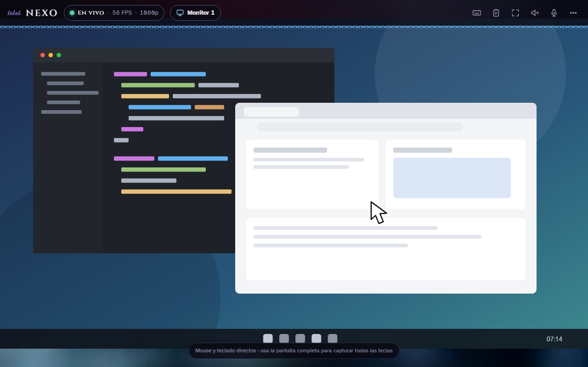
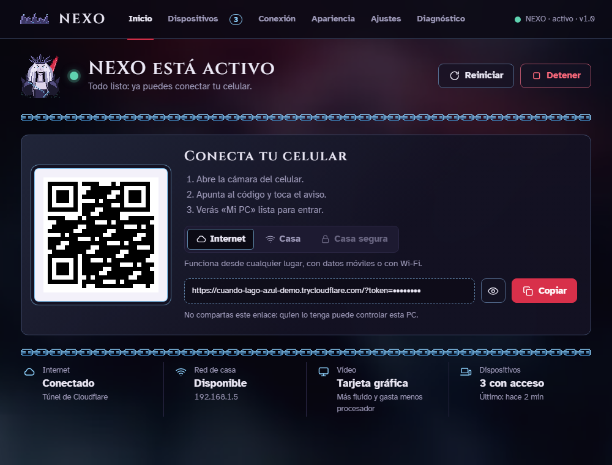
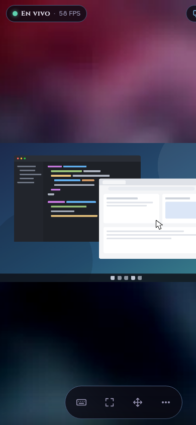
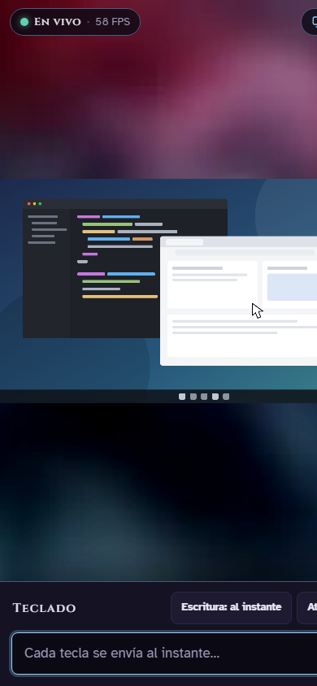
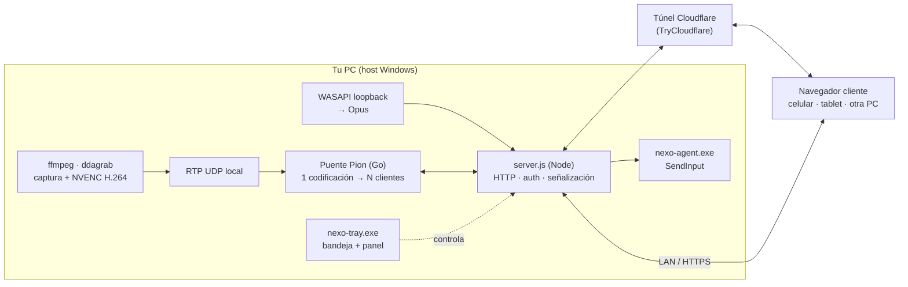

<div align="center">


# NEXO

**Tu PC en cualquier pantalla. Sin instalar nada en el cliente.**

Convierte un celular, una tablet u otra computadora en la *pantalla, teclado, mouse, altavoz y micrófono* de tu PC,
desde el navegador, por la red de casa o por Internet.

[](https://github.com/omarcortijocanaza-ai/nexo-remoto/releases/latest)
&nbsp;


<br>



</div>

---

## ¿Qué es?

NEXO es un **escritorio remoto casero**: abres un enlace (o escaneas un QR) en cualquier navegador y ves y controlas tu
PC con latencia baja, con sonido, y hasta hablando por el micrófono de tu celular como si estuviera enchufado a la PC.

Nació para un caso concreto: el ISP del autor (WIN Perú) está tras **CGNAT**, así que no hay IP pública ni puertos que
abrir. NEXO resuelve eso con un túnel de Cloudflare que se crea solo, **sin cuenta, sin router, sin configurar nada**.

| | |
|---|---|
| 🖥️ **Pantalla** | Vídeo H.264 codificado en tu GPU (NVENC), compartido entre varios clientes a la vez. 720p / 900p / 1080p, 30-60 FPS, calidad automática |
| 🖱️ **Mouse y teclado** | En PC, el puntero real; en celular, modos *Mover* (toque = clic, deslizar = scroll con inercia) y *Directo* (dibujar, arrastrar sliders) |
| 🔊 **Audio de la PC** | Lo que suena en tu PC suena en el cliente (WASAPI loopback → Opus). Sin «Mezcla estéreo» ni cables |
| 🎙️ **Micrófono del celular** | Tu celular se convierte en el micrófono de la PC (vía VB-CABLE) |
| 🌍 **LAN o Internet** | Elige: sólo casa, sólo Internet o ambos. HTTPS local opcional |
| 📁 **Portapapeles y archivos** | Copia texto entre dispositivos y envía archivos |
| 🔐 **Acceso seguro** | Contraseña con scrypt, dispositivos emparejados con cookie, código de emparejamiento, token rotatorio |
| 🎨 **Apariencias** | Varios temas visuales (Rey Muerto, Cabina, Cianotipo, Bloque…), claro/oscuro |

<div align="center">

<br><sub>El panel de la bandeja de Windows: inicia/detiene, QR para conectar el celular, dispositivos, ajustes y diagnóstico.</sub>
</div>

<div align="center">
<br>

&nbsp;&nbsp;

<br><sub>El cliente en un celular: controles flotantes, teclado remoto y modos táctiles.</sub>
</div>

> Las capturas usan el modo demo del cliente (`?demo=1`), que dibuja un escritorio de muestra: nunca se captura una pantalla real.

---

## Pruébalo en 2 minutos (Windows)

1. Descarga **`NEXO-Setup-1.0.4-x64.exe`** desde [**Releases**](https://github.com/omarcortijocanaza-ai/nexo-remoto/releases/latest).
2. Ejecútalo y acepta el aviso de Windows (el instalador **no está firmado**; ver [Seguridad](#-seguridad-y-privacidad)).
3. Abre **NEXO** desde el menú Inicio, entra en **Ajustes** y crea tu usuario y contraseña de NEXO
   (no son los de Windows).
4. En la pestaña **Inicio** aparece un **QR**. Escanéalo con la cámara del celular y listo.

**Requisitos:** Windows 10 (2004+) u 11 x64, sesión de escritorio abierta, Internet durante la instalación y permisos de
administrador. Para vídeo acelerado, una **NVIDIA con NVENC** (GTX/RTX 10 en adelante); sin ella hay modo CPU, más lento.
No necesitas instalar Git, Go, Node ni PowerShell: el instalador trae todo y descarga FFmpeg desde su distribuidor
oficial (Gyan) por HTTPS **verificando su SHA-256**.

Opcional: [VB-CABLE](https://vb-audio.com/Cable/) para usar el micrófono del celular.

<details>
<summary><b>Verificar la descarga (SHA-256)</b></summary>

```text
AD8258BA05D4DF72B689F7138E77661AFA28A5194EF345188072E592EF630E23  NEXO-Setup-1.0.4-x64.exe
```

```powershell
(Get-FileHash .\NEXO-Setup-1.0.4-x64.exe -Algorithm SHA256).Hash
```
</details>

> ⚠️ **Estado: beta.** Se ha probado extensamente en una PC (Ryzen 5 3600 + RTX 3060 Ti, dos monitores 1080p). Todavía
> falta la aceptación en una segunda PC limpia. Si lo pruebas, [abre un issue](../../issues) con lo que veas.

---

## Cómo funciona



**Ideas de diseño que importan**

- **Una sola codificación, muchos espectadores.** FFmpeg codifica *una vez* en la GPU; el puente [Pion](https://github.com/pion/webrtc)
  reparte ese mismo flujo RTP a cada cliente y conserva la secuencia RTP al cambiar de monitor o de perfil, así nadie se congela.
- **Dos canales de entrada.** Teclado y clics van por un canal *confiable*; el movimiento del mouse por uno *sin retransmisiones*,
  para que un paquete perdido nunca atrase el cursor.
- **Calidad adaptable.** Si detecta congestión baja el perfil solo; si la red mejora, vuelve a subir.
- **Cadena de respaldos.** NVENC por GPU → WebRTC por CPU (VP8) → JPEG por WebSocket. Siempre hay algo que ver.
- **Texto por Unicode, no por portapapeles.** El agente nativo escribe con `SendInput`, así que `ñ`, tildes y emojis no dependen
  de la distribución del teclado ni pisan lo que tienes copiado.
- **El host se apaga solo cuando nadie mira.** Sin clientes, la captura y NVENC se detienen al minuto.
- **TURN opcional.** Para redes muy restrictivas se puede añadir un servidor TURN (Cloudflare u otro) desde el panel.

### Dos hosts, un mismo cliente

| | **Windows** (principal) | **Linux** (origen del proyecto) |
|---|---|---|
| Captura | `ffmpeg` `ddagrab` → NVENC | `wf-recorder` → NVENC → GStreamer |
| Entrada | `nexo-agent.exe` (`SendInput`) | `wtype`, `wlrctl`, X11 |
| Audio del sistema | WASAPI loopback | PipeWire |
| Micrófono del celular | VB-CABLE | null-sink de PipeWire |
| Sesión aislada «NEXO independiente» | No (Windows sólo da una sesión gráfica) | Sí (segunda sesión Hyprland) |
| Pantalla de login | No (escritorio protegido de Windows) | Sí (greeter SDDM) |
| Guía | [`README-WINDOWS.md`](README-WINDOWS.md) | [`README-LINUX.md`](README-LINUX.md) |

---

## 🔐 Seguridad y privacidad

- **Nada de secretos en el repositorio.** El token, el hash de la contraseña, los dispositivos y los registros viven en
  `%LOCALAPPDATA%\NEXO\state` y están en `.gitignore`. Un verificador del paquete (`scripts/windows/verify-package.js`)
  rechaza cualquier instalador que lleve archivos privados.
- Contraseña con **scrypt**; cada dispositivo recibe una **cookie propia** que se puede revocar desde el panel.
- El enlace de Internet lleva un token: **quien lo tenga controla tu PC.** Trátalo como una contraseña.
- Las reglas de firewall se limitan al **perfil de red Privado**. No cambia suspensión, inicio de sesión automático ni
  contraseñas de Windows.
- Los binarios de terceros (FFmpeg, cloudflared) se descargan con **SHA-256 verificado**.
- El instalador **no está firmado** con certificado de editor: Windows SmartScreen avisará. Puedes comprobar el SHA-256 de
  arriba o compilarlo tú mismo.

Si encuentras un problema de seguridad, por favor avísalo en privado desde la pestaña *Security* del repositorio.

---

## Construirlo desde el código

```powershell
git clone https://github.com/omarcortijocanaza-ai/nexo-remoto.git C:\nexo\nexo-remoto
cd C:\nexo\nexo-remoto
pwsh scripts\windows\setup.ps1      # instala Node, Go, FFmpeg, cloudflared con winget
npm ci
pwsh scripts\windows\build.ps1      # compila los binarios de Go a bin\win\
npm test                            # pruebas de Node
```

Instalador: [`installer/COMPILAR.md`](installer/COMPILAR.md) (Inno Setup). Detalle de uso diario, solución de problemas y
matriz de aceptación en [`README-WINDOWS.md`](README-WINDOWS.md).

Prueba el cliente sin tocar tu PC: `node scripts/ui/servir-cliente.js` y abre `http://127.0.0.1:18777/?demo=1`.

## Mapa del código

| Ruta | Qué hay |
|---|---|
| `server.js` | HTTP, emparejamiento, login, archivos, portapapeles, señalización WebRTC, colas de entrada |
| `launcher.js` | Arranca servidor, puente de vídeo y túnel; guarda el token |
| `gpu-webrtc/` | Puente Pion en **Go**: una codificación H.264 compartida entre N clientes (+ ICE/TURN) |
| `native/tray/` | **nexo-tray.exe**: bandeja de Windows y panel de control (Go + web embebida) |
| `native/` | `nexo-agent.exe` (entrada con `SendInput`) y `nexo-super-bridge.exe` |
| `platform/windows/` | Captura con FFmpeg, audio, micrófono virtual |
| `webrtc-host.js` | Respaldo WebRTC por CPU (VP8 + Opus) |
| `index.html`, `microfono.html` | Cliente web (sin dependencias) |
| `keyboard-translation.js` | Eventos de teclado → órdenes, compartido navegador/servidor |
| `installer/` | Instalador Inno Setup y su configuración |
| `scripts/windows/` | Instalación, build, empaquetado, doctor y control |
| `docs/` | Guía de uso móvil y bosquejos de diseño |
| `headless/`, `greeter/` | Sólo Linux: sesión aislada y pantalla de login |

El proyecto se migró de Linux a Windows en **11 fases** (F0-F10), cada una con ejecutor, revisor, verificaciones con salida
esperada y etiqueta `fN-ok`. Las bitácoras y el plan completo se conservan en el historial de git (etiquetas `f0-ok` … `f10-ok`).

## Pruebas

Más de 30 archivos de pruebas en Node (`test/`, `node --test`) y Go (`native/tray`, `gpu-webrtc`) cubren autenticación,
traducción de teclado, ICE/TURN, TLS de LAN, apariencia, el paquete del instalador y el panel.

---

## Créditos y avisos

- Construido sobre [Pion WebRTC](https://github.com/pion/webrtc), [FFmpeg](https://ffmpeg.org/), [cloudflared](https://github.com/cloudflare/cloudflared),
  [`@roamhq/wrtc`](https://github.com/WonderInventions/node-webrtc) y [`ws`](https://github.com/websockets/ws). Licencias en
  [`THIRD_PARTY_NOTICES.md`](THIRD_PARTY_NOTICES.md). Las fuentes son de Google Fonts bajo SIL OFL 1.1.
- La estética «Rey Muerto» está inspirada en el personaje **Viego** de *League of Legends*. Viego y League of Legends son marcas
  de **Riot Games, Inc.**; NEXO es un proyecto de aficionado, **no está afiliado ni respaldado por Riot Games**, y el arte de
  Riot que aparece como fondo pertenece a su titular.
- NEXO es una herramienta para controlar **tu propia computadora**. No la uses en equipos ajenos sin permiso.

<div align="center"><sub>Hecho con paciencia, café y demasiados milisegundos de latencia por <b>Letzus</b>.</sub></div>
